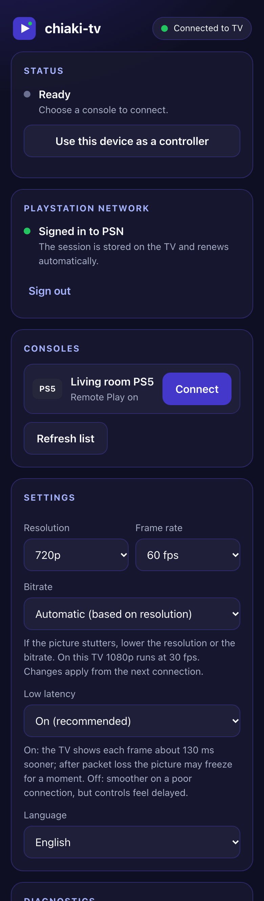
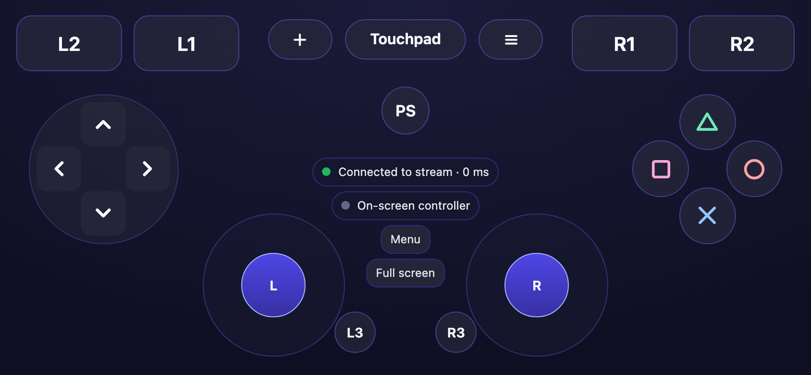

# chiaki-tv

PS5 Remote Play on a Samsung Tizen TV, built on the protocol library of [chiaki-ng](https://github.com/chiaki-ng/chiaki-ng).

The TV connects to the console itself through PSN, so the console can be on another network. A phone sets it up and can also act as the controller.


This is a working prototype. It has been tested on one TV, a 2017 UE49MU7400 (Tizen 3.0), with a PS5.

## What it does

- Connects to a PS5 through PSN remote connection. No port forwarding on the console side.
- Decodes 720p60 H.264 with the TV's hardware decoder and plays Opus audio.
- Setup from a phone: the TV shows an address and a four-digit code. The page served by the TV handles the PSN sign-in, the console list and the settings. The PSN password is typed only on Sony's page.
- Browser controller: the same page turns a phone or PC into the controller, with a touch layout, a keyboard and mouse mode with remappable keys, or a gamepad connected to that device.
- Stream menu on L1 + R1 + L3 + R3 with bitrate, frame rate, decoder delay and lost frames.
- English and Turkish.

| TV home | Phone setup | Touch controller |
|---|---|---|
|  |  |  |

The TV cannot take screenshots of itself. The stream pictures here use a frame read back from the TV's video output, with the interface rendered by a desktop browser on top. The other pictures are the same pages rendered in a desktop browser with sample data.

## Limits

- One TV model tested. Other Tizen versions and other consoles are untested.
- About 38 of the 60 decoded frames per second reach the screen. The limit is the TV's compositor.
- 1080p runs at 30 fps. The decoder cannot keep up with 1080p60.
- Network to screen takes about 120 ms on this TV in low-latency mode, plus the network path. See [Latency](#latency).
- No HEVC, HDR, microphone, haptics, touchpad surface or motion sensors.
- A controller plugged into the TV itself is read through the TV's Gamepad API, but that path is untested.
- Only PSN remote connection is implemented. Direct connection on the local network and console registration with a PIN are not.
- The setup page and the controller are served over plain HTTP on the local network. A four-digit pairing code protects them, with a lockout after five wrong attempts.

## How it works

Samsung TVs from these years run web apps on Chromium 47, which has no UDP and no WebAssembly. They do run Native Client. `chiaki-tv/native` builds chiaki-ng's `lib/` as an ARM Native Client module with mbedTLS, and adds:

- a video path through `PPB_VideoDecoder` and GLES2, and audio through `PPB_Audio`
- a small HTTP and WebSocket server on port 8730 for the setup page and the browser controller
- an H.264 SPS rewriter for low latency

`chiaki-tv/app` is the TV interface (ES5, for Chromium 47). `chiaki-tv/setup` holds the phone pages, which are embedded in the module. `tv-probe` contains the tools used to talk to the TV: an sdb client, a widget signer and a DevTools client.

`chiaki-tv/native/patch_chiaki.py` patches the chiaki-ng sources at build time. Three of those fixes apply to every platform and are in [`patches/`](patches) as patches against chiaki-ng.

## Latency

The TV's decoder returns a picture only after it holds as many frames as the stream declares as reference frames, plus about five. The PS5 declares nine, which costs about 230 ms. Low-latency mode rewrites the SPS to one reference frame and brings the decoder delay to about 95 ms.

The PS5 sometimes sends a recovery frame that references a frame seven to nine back, usually after packet loss. With one reference frame the decoder no longer has it, so the client skips that frame and asks for a key frame. The picture can freeze briefly when that happens. The setting can be turned off on the setup page.

## Building

Requirements:

- A Samsung TV with developer mode enabled and this computer's address set as Host PC IP.
- Samsung's Pepper 47 toolchain (`NaCl_SDK_v47f`) from the Samsung Developers site. Set `NACL_SDK_ROOT` to its `pepper_47` directory, or leave it at `~/Downloads/NaCl_SDK_v47f/pepper_47`.
- Python 3 and OpenSSL.
- Samsung's certificate generator files in `tv-probe/vendor/certgen`, used once to create a signing certificate.

Third-party sources are not in this repository. `chiaki-tv/native/build.py` expects them under `chiaki-tv/vendor`:

| Directory | Version |
|---|---|
| `chiaki-ng` | commit `43728af`, with its `third-party` submodules |
| `nanopb` | 0.4.9.1 |
| `jerasure`, `gf-complete` | the forks chiaki-ng uses |
| `mbedtls` | 2.28.9 |
| `opus` | 1.5.2 |
| `json-c` | 0.17 |
| `curl` | 8.10.1 |
| `cacert.pem` | Mozilla CA bundle from curl.se |

It also expects `protoc` 28.3 in `chiaki-tv/tools/host/protoc/bin` and a Python environment with `protobuf` 5.28.3 in `chiaki-tv/tools/host/venv`. A script that fetches all of this does not exist yet.

Then, from `chiaki-tv`:

```bash
export TV_IP=192.168.1.50      # the TV's address
python3 native/build.py        # dependencies and the module
python3 tvbuild.py build       # signed package: build/ChiakiTv.wgt
python3 tvbuild.py install
python3 tvbuild.py launch
```

## Using it

1. Open chiaki-tv on the TV. It shows an address and a code.
2. Open the address on a phone on the same network and enter the code.
3. Sign in to PSN from that page. Sony redirects to a blank page; copy its address and paste it back.
4. Pick the console on the TV, or tap Connect on the phone.
5. For a controller, tap "Use this device as a controller" on the phone. A gamepad paired with the phone or PC is forwarded too.

During a stream, L1 + R1 + L3 + R3 opens the stream menu. On the TV remote, Info opens it and holding Back asks whether to disconnect.

## Development tools

All in `chiaki-tv/tools`:

- `mockserver.py` serves the three interfaces without a TV.
- `tvdebug.py` runs the app on the TV in debug mode, follows its log over UDP, measures latency and resolves crash addresses. The log, capture and measurement features need a module built with `CHIAKI_TV_DEBUG=1 python3 native/build.py`; the normal build leaves those endpoints out.
- `padtest.py` checks the controller WebSocket on the TV.
- `screenshots.py` regenerates the pictures in `chiaki-tv/docs/screenshots`.
- `sfiscan.py` scans the module for instructions the Native Client validator rejects.

Code comments and tool output are in Turkish.

## License

GNU Affero General Public License v3.0, the same as chiaki-ng. See [LICENSE](LICENSE). The chiaki-ng library carries an additional OpenSSL linking exception.

This project is not affiliated with or endorsed by Sony Interactive Entertainment or Samsung. PlayStation and PS5 are trademarks of Sony Interactive Entertainment.
