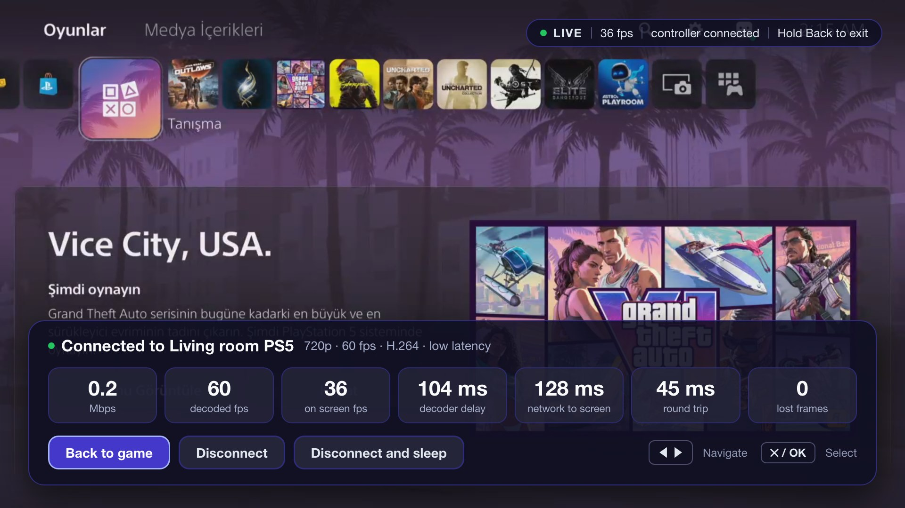
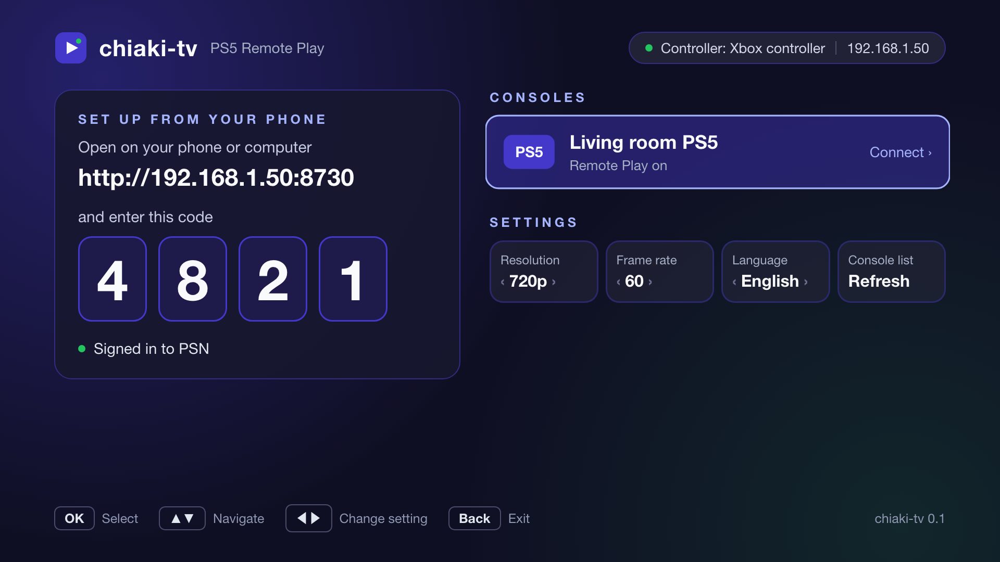

# chiaki-tv

PS5 Remote Play on a Samsung Tizen TV, built on the protocol library of [chiaki-ng](https://github.com/chiaki-ng/chiaki-ng).

The TV connects to the console itself through PSN, so the console can be on another network. A phone sets it up and can also act as the controller.



This is a working prototype. It has been tested on one TV, a 2017 UE49MU7400 (Tizen 3.0), with a PS5.

## Install on your TV

It takes about ten minutes. You do not need to build anything.

You need:

- A Samsung smart TV that still has Native Client. That is roughly the 2016 to 2019 models; only a 2017 model has been tested.
- A computer on the same network as the TV, with [Python 3](https://www.python.org/downloads/).
- A PS5 signed in to your PSN account, with Remote Play enabled (Settings > System > Remote Play).

### 1. Turn on developer mode on the TV

You do this once.

1. On the TV open **Apps**.
2. Press **1 2 3 4 5** on the remote. A "Developer mode" dialog opens.
3. Set Developer mode to **On**.
4. In **Host PC IP** enter the address of your computer.
5. Hold the power button until the TV restarts.

Note the TV's own address too: Settings > General > Network > Network Status > IP Settings.

### 2. Download chiaki-tv

Get the latest `chiaki-tv-*.zip` from [Releases](https://github.com/MuratDugan/chiaki-tv/releases) and unpack it.

### 3. Run the installer

In the unpacked folder, with the TV's address:

```bash
python3 install.py 192.168.1.50
```

It sends the app to the TV, installs it and starts it:

```text
[1/4] Checking the TV at 192.168.1.50
      connected to UE49MU7400
[2/4] Sending the package (1.3 MB)
[3/4] Installing
[4/4] Starting chiaki-tv

Installed.
Next: on your phone, open  http://192.168.1.50:8730  and enter the code shown on the TV.
```

### 4. Sign in from your phone



1. The TV shows an address and a four-digit code. Open the address on your phone and enter the code.
2. Tap **Open the Sony sign-in page** and sign in to PSN. Your password is typed only on Sony's page.
3. Sony then shows a blank page whose address contains "redirect". Copy that whole address, go back, and paste it.
4. Your PS5 appears in the list on the TV and on the phone.

You sign in once. The TV keeps the session.

### 5. Play

Select the console on the TV and press OK. Connecting takes up to a minute while PSN wakes the console.

For a controller, tap **Use this device as a controller** on the phone page. You get an on-screen controller, and a gamepad paired with the phone is passed through. On a computer the same page offers keyboard and mouse.

During a stream:

- **L1 + R1 + L3 + R3** opens the stream menu (Info on the TV remote, or the Menu button on the phone).
- Holding **Back** on the TV remote asks whether to disconnect.

### If something goes wrong

| What you see | What to do |
|---|---|
| Installer: "Nothing answers at ..." | The TV is off, on another network, or the address is wrong. |
| Installer: "The TV refused the connection" | Developer mode is off, or Host PC IP is not this computer. Fix it and restart the TV by holding the power button. |
| Installer: "The TV did not install the package" | Your TV may not accept the signature of the released package. [Build from source](docs/BUILDING.md), which signs with your own certificate. |
| TV shows "The module could not be loaded" | This TV has no Native Client, or a different CPU. chiaki-tv will not run on it. |
| "Could not connect to the console" | Check that the PS5 is on or in rest mode, that Remote Play is enabled, and that "Stay Connected to the Internet" is on under Power Saving. Wait half a minute before retrying after a cancelled attempt. |
| Picture freezes for a moment now and then | Turn off Low latency on the phone page's settings. |
| Something else | Open the phone page, scroll to Diagnostics, tap Show log, and include it in an issue. |

To update, download the new archive and run the installer again. To remove the app: `python3 install.py 192.168.1.50 --uninstall`.

## What it does

- Connects to a PS5 through PSN remote connection. No port forwarding on the console side.
- Decodes 720p60 H.264 with the TV's hardware decoder and plays Opus audio.
- Setup from a phone: the TV shows an address and a four-digit code. The page served by the TV handles the PSN sign-in, the console list and the settings. The PSN password is typed only on Sony's page.
- Browser controller: the same page turns a phone or PC into the controller, with a touch layout, a keyboard and mouse mode with remappable keys, or a gamepad connected to that device.
- Stream menu on L1 + R1 + L3 + R3 with bitrate, frame rate, decoder delay and lost frames.
- English and Turkish.

| TV home | Phone setup | Touch controller |
|---|---|---|
|  |  |  |

The TV cannot take screenshots of itself. The stream pictures here use a frame read back from the TV's video output, with the interface rendered by a desktop browser on top. The other pictures are the same pages rendered in a desktop browser with sample data.

## Limits

- One TV model tested. Other Tizen versions and other consoles are untested.
- About 38 of the 60 decoded frames per second reach the screen. The limit is the TV's compositor.
- 1080p runs at 30 fps. The decoder cannot keep up with 1080p60.
- Network to screen takes about 120 ms on this TV in low-latency mode, plus the network path. See [Latency](#latency).
- No HEVC, HDR, microphone, haptics, touchpad surface or motion sensors.
- A controller plugged into the TV itself is read through the TV's Gamepad API, but that path is untested.
- Only PSN remote connection is implemented. Direct connection on the local network and console registration with a PIN are not.
- The setup page and the controller are served over plain HTTP on the local network. A four-digit pairing code protects them, with a lockout after five wrong attempts.

## How it works

Samsung TVs from these years run web apps on Chromium 47, which has no UDP and no WebAssembly. They do run Native Client. `chiaki-tv/native` builds chiaki-ng's `lib/` as an ARM Native Client module with mbedTLS, and adds:

- a video path through `PPB_VideoDecoder` and GLES2, and audio through `PPB_Audio`
- a small HTTP and WebSocket server on port 8730 for the setup page and the browser controller
- an H.264 SPS rewriter for low latency

`chiaki-tv/app` is the TV interface (ES5, for Chromium 47). `chiaki-tv/setup` holds the phone pages, which are embedded in the module. `tv-probe` contains the tools used to talk to the TV: an sdb client, a widget signer and a DevTools client.

`chiaki-tv/native/patch_chiaki.py` patches the chiaki-ng sources at build time. Three of those fixes apply to every platform and are in [`patches/`](patches) as patches against chiaki-ng.

## Latency

The TV's decoder returns a picture only after it holds as many frames as the stream declares as reference frames, plus about five. The PS5 declares nine, which costs about 230 ms. Low-latency mode rewrites the SPS to one reference frame and brings the decoder delay to about 95 ms.

The PS5 sometimes sends a recovery frame that references a frame seven to nine back, usually after packet loss. With one reference frame the decoder no longer has it, so the client skips that frame and asks for a key frame. The picture can freeze briefly when that happens. The setting can be turned off on the setup page.

## Building from source

See [docs/BUILDING.md](docs/BUILDING.md). It also lists the development tools.

## License

GNU Affero General Public License v3.0, the same as chiaki-ng. See [LICENSE](LICENSE). The chiaki-ng library carries an additional OpenSSL linking exception.

This project is not affiliated with or endorsed by Sony Interactive Entertainment or Samsung. PlayStation and PS5 are trademarks of Sony Interactive Entertainment.
